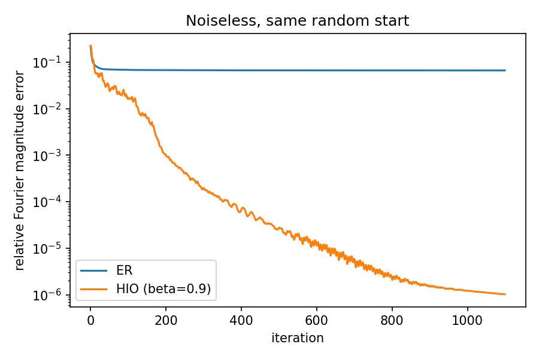
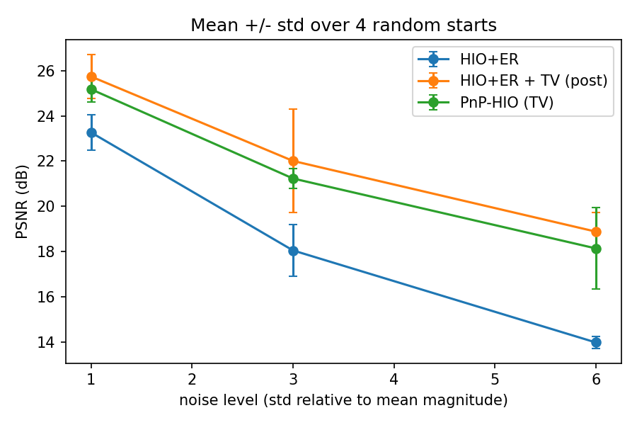
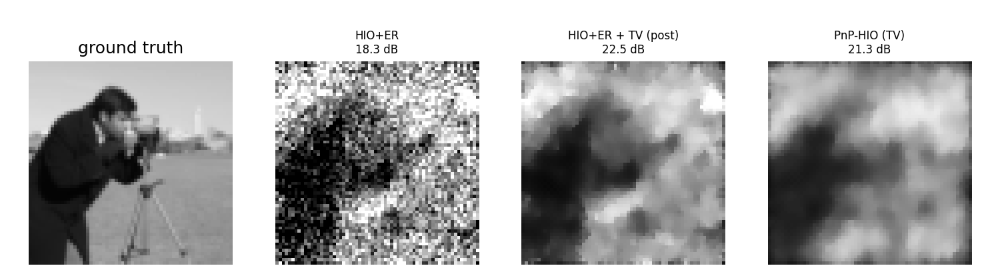
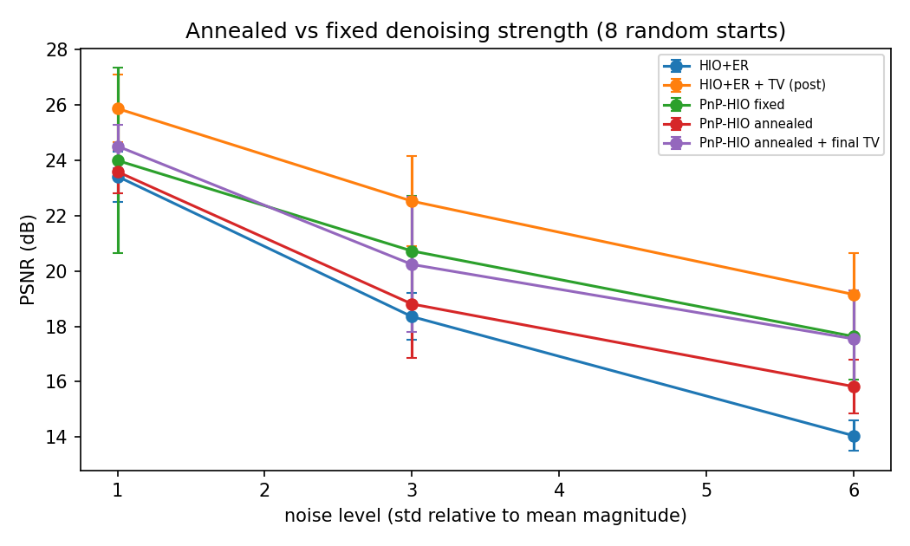

A small learning project: classical **Fourier phase retrieval** algorithms implemented in
Python/NumPy, plus a first look at what a **plug-and-play denoising prior** does inside the loop.
It is a re-implementation of well-known textbook methods on simulated data, **not original research**.

I wrote it while starting to study the phase retrieval literature (ADMM-based and
diffusion-based methods) and wanted to understand the classical baselines that those
papers build on.

## Problem

Recover a real, non-negative image `x` with known support from the magnitude of its
oversampled 2D Fourier transform, `y = |F x|`. The Fourier phase is lost. With 2x
oversampling per dimension the problem is (almost always) uniquely solvable up to
trivial ambiguities (translation and 180-degree rotation, the "twin image").

## What is implemented (`pr.py`)

| Function | What it does |
|---|---|
| `make_problem` | zero-pads the image, builds the support mask, computes (noisy) Fourier magnitudes |
| `error_reduction` | Gerchberg-Saxton / Error Reduction (ER) |
| `hio` | Hybrid Input-Output (HIO), Fienup 1982 |
| `hio_then_er` | the usual recipe: many HIO steps, a few ER steps at the end |
| `pnp_hio` | HIO with a plug-and-play denoising step (a deliberately simple variant) |
| `align_to_reference` | removes shift / twin ambiguity before computing PSNR |

## Results

Setup: 64x64 "cameraman" image (from scikit-image), zero-padded to 128x128, real and
non-negative object, known support, random initialisation. 1000 HIO iterations (+100 ER).
Everything below is reproduced by `python experiments.py` (about 3 minutes).

### 1. ER stagnates, HIO does not (noiseless)



Over 8 random starts, ER alone (1100 iterations) never reached a good solution
(PSNR 18-24 dB, 0/8 successes). HIO followed by a few ER steps recovered the image
in 8/8 runs (PSNR above 100 dB, i.e. exact up to numerical precision).
A run counts as a success if PSNR > 40 dB.

### 2. Noisy magnitudes and a denoising prior

Gaussian noise is added to the magnitudes, with standard deviation equal to
`noise_level` times the mean magnitude. This is a harsh noise model, because the mean
magnitude is much larger than most high-frequency magnitudes.

| noise level | HIO+ER | HIO+ER, then TV denoising | PnP-HIO (TV inside the loop) |
|---|---|---|---|
| 1.0 | 23.4 dB | 25.9 dB | 24.0 dB |
| 3.0 | 18.4 dB | 22.5 dB | 20.7 dB |
| 6.0 | 14.1 dB | 19.2 dB | 17.6 dB |

Mean PSNR over 8 random starts. The same TV denoiser (weight 0.2) is used everywhere and was
not tuned per noise level.





**Take-aways (and limits):**

- A denoising prior clearly helps when the magnitudes are noisy.
- In this simple setup, denoising the final result of HIO+ER was **better** than putting the
  denoiser inside the HIO loop. I did not find a configuration where the in-loop version
  was reliably better. This does not say anything about the learned-denoiser methods in the
  literature, which are much more careful than my version.
- Results come from one test image, one noise model, one fixed denoiser setting and 8
  random starts, so they should be read as a demonstration, not a benchmark.
### 3. Does annealing the denoising strength explain the in-loop result?

In the experiments above, the denoiser strength inside the HIO loop was fixed. The related
literature anneals the noise level of the denoiser during the iterations, so I tested whether
decreasing the TV weight over the iterations (0.2 to 0.01, geometric schedule, applied every 10
iterations) makes in-loop denoising competitive (`annealing_experiment.py`).

| noise level | HIO+ER | post TV | PnP-HIO fixed | PnP-HIO annealed | annealed + final TV |
|---|---|---|---|---|---|
| 1.0 | 23.4 dB | 25.9 dB | 24.0 dB | 23.6 dB | 24.5 dB |
| 3.0 | 18.4 dB | 22.5 dB | 20.7 dB | 18.8 dB | 20.2 dB |
| 6.0 | 14.1 dB | 19.2 dB | 17.6 dB | 15.8 dB | 17.6 dB |

Mean PSNR over 8 random starts (standard deviations are in `results/annealing.json`).



In this setup, annealing did **not** help: the annealed variant was worse than the fixed one at
every noise level, and denoising once after reconstruction remained the best option. With a
simple TV denoiser, one test image and one annealing schedule, this only rules out this specific
explanation; it says nothing about learned denoisers or other schedules.

## Run it

```bash
pip install -r requirements.txt
python -m unittest -v        # 5 small sanity tests
python experiments.py        # full experiments, writes figures to results/
python experiments.py --quick
python annealing_experiment.py   # annealing test, about 2.5 minutes
```

## References

- J. R. Fienup, "Phase retrieval algorithms: a comparison," *Applied Optics* 21(15), 1982.
- R. W. Gerchberg and W. O. Saxton, "A practical algorithm for the determination of phase from image and diffraction plane pictures," *Optik* 35, 1972.
- S. V. Venkatakrishnan, C. A. Bouman, B. Wohlberg, "Plug-and-Play priors for model based reconstruction," *IEEE GlobalSIP*, 2013.
- Recent phase retrieval work from METU SPACE Lab (ADMM-based, plug-and-play HIO and diffusion-based methods), which motivated this project: https://github.com/METU-SPACE-Lab

## Notes on how this was made

Written by Kaan Topak with the code developed with the help of an AI assistant.
The algorithms are the standard ones from the references above; no code from other repositories was copied.

## License

MIT
